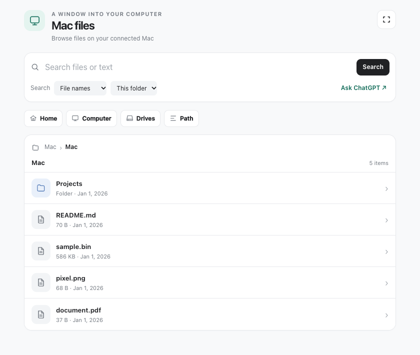

# Mac Files

A read-only MCP server and interactive file browser for a Mac. Browse folders, search filenames or UTF-8 text, preview files, and bring selected information into a compatible MCP host.

This is a prototype. It runs with the permissions of the macOS user that starts it and can expose sensitive files to its connected client. Review the access and privacy notes below before connecting it to a host.



*Browser shown in the local synthetic host with fixture data.*

## What it does

- Browse directories and inspect file metadata.
- Search filenames or UTF-8 file contents, with continuation and coverage notices for incomplete searches.
- Preview text, PNG, JPEG, GIF, WebP, and PDF pages. Read selectable PDF text for analysis.
- Prepare original files for download through supported host capabilities, subject to the limitations below.

The browser is an [MCP App](https://modelcontextprotocol.io/docs/extensions/apps); the browsing and reading tools can also be used by an MCP client without the interface.

## Requirements

- macOS, with Swift and PDFKit available for PDF preview and text extraction.
- Node.js 22 or later and npm.
- An MCP client; the interactive browser requires a host that supports MCP Apps.

## Get started

Install dependencies and run the tests from the repository root:

```sh
cd server
npm ci --ignore-scripts
npm test
```

For a local HTTP client, start the server in the same directory:

```sh
FILE_BROWSER_ROOT="$HOME/Documents" npm start
```

The endpoint is `http://127.0.0.1:8787/mcp`. Set `PORT` to change the port. `FILE_BROWSER_ROOT` must be an existing absolute directory. Omit it to use `/`, which permits access to all paths available to the process; the browser initially opens the user's home directory when it is within the configured root.

Alternatively, an MCP client that launches a stdio server can use `node` as its command and the absolute path to `server/stdio-server.js` as its argument. Set `FILE_BROWSER_ROOT` in the client's environment to scope its access. Client configuration formats vary; use your client's documentation for the exact syntax. The server must remain running, and a remote connection requires a separately configured authenticated transport. The optional local HTTP listener is not such a transport.

## Access and privacy

The server can read files accessible to its process. macOS may deny access to protected folders until the application launching Node has the relevant permission; this project does not grant Full Disk Access. Choose a narrow root where practical. The root setting is a convenience boundary, not a hardened sandbox against a malicious local process racing filesystem changes.

The HTTP listener binds to loopback and rejects non-loopback requests, unexpected `Host` headers, and requests with an `Origin` header. These checks are **not authentication**. Do not expose the listener or an unauthenticated proxy to the internet. Remote use requires an authenticated and authorized connection, such as an appropriately configured [Secure MCP Tunnel](https://developers.openai.com/api/docs/guides/secure-mcp-tunnels), and careful control of who can access it.

Names, paths, search results, metadata, and file contents returned by tools may be visible to the connected host and assistant. Image and PDF previews and original file bytes are delivered to the app through tool metadata. Preparing a host-provided download link may upload the selected file to that host. Review your host's privacy and retention policies before connecting sensitive files.

## Current limits

- Search is bounded and resumable; inspect its coverage notices. It skips symbolic links and binary or non-UTF-8 files during content search. PDF and Office text is not extracted by general search. Continuation cursors expire after five minutes of inactivity.
- Text previews show up to 128 KiB; image previews are limited to 4 MiB. PDF snapshots are limited to 32 MiB and use PDFKit; scanned PDFs do not get OCR.
- Download preparation is limited to 32 MiB in memory. Whether the host accepts the download, or a phone can save it, depends on the host and device and has not been verified end to end.
- `FILE_BROWSER_ROOT` and macOS permissions govern filesystem access. Search results may be incomplete when locations are unreadable.

## Development

Run `npm test` in `server` for backend, stdio, and PDF tests. The [browser test guide](testing/README.md) describes synthetic and real-server local fixtures; these do not establish behavior in a particular hosted app or on a phone. See [server/README.md](server/README.md) for protocol and implementation details.
